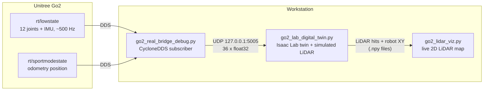

# Unitree Go2: real-to-sim digital twin

A live digital twin of a Unitree Go2 quadruped in NVIDIA Isaac Lab. While the real robot walks
(driven by its own remote), its joint angles, body orientation and odometry position are streamed
into a simulated copy of the lab. The twin mirrors the robot in real time and runs a simulated
16-channel LiDAR in the virtual room, with a live 2D map of the hits.

The pipeline is listen-only: nothing here sends commands to the robot.

## How it works



1. **Bridge** (`go2_real_bridge_debug.py`) subscribes to the robot's DDS topics with the Unitree
   SDK and forwards every `rt/lowstate` message as one UDP packet of 36 floats: joint positions
   (0–11), joint velocities (12–23), gyroscope x/y (24–25), IMU quaternion w/x/y/z (26–29), and
   odometry position and velocity from `rt/sportmodestate` (30–35).
   `go2_real_bridge.py` is the minimal version: joints and IMU only (30 floats, no position).
2. **Digital twin** (`go2_lab_digital_twin.py`) builds a to-scale model of the 15 ft × 10 ft lab
   area in Isaac Lab (checkered floor, boundary lines, table, cylinders) with the Go2 model in it.
   Every simulation step it applies the latest packet:
   - **Joints:** the real angles are taken relative to a calibrated real standing pose and added
     to the matching standing pose in simulation, after reordering from the robot's joint order
     to Isaac Lab's.
   - **Orientation:** the IMU quaternion sets the base orientation.
   - **Position:** odometry XY, relative to the first packet, moves the twin from its spawn point.

   A 16-channel, 360° ray-cast LiDAR on the twin's base scans the virtual room at 10 Hz.
3. **LiDAR map** (`go2_lidar_viz.py`) plots the latest LiDAR hits and the robot's position.

`go2_common.py` holds the shared pieces: the joint-order conversion, the Unitree SDK and
CycloneDDS setup, and an Isaac Lab 3 compatibility shim that moves CPU tensors to the GPU.

## Calibration

The twin only looks right if a few values match the real robot and the real room. They are
constants at the top of `go2_lab_digital_twin.py` (and the joint order in `go2_common.py`), and
must be recalibrated for a different robot, a different standing pose or a different room.

| Value | Where | What it is | How it's obtained |
|---|---|---|---|
| Joint order (`HW_TO_ISAAC`, `ISAAC_TO_HW`) | `go2_common.py` | maps the robot's 12 joints to Isaac Lab's 12 joints | from the joint names on both sides (see step 1 below) |
| `REAL_STANDING` | twin | the real robot's standing joint angles, robot order (rad) | measured: steps 2–4 |
| `SIM_STANDING` | twin | the simulated Go2's standing joint angles, Isaac Lab order (rad) | measured: steps 2–4, fine-tuned in step 5 |
| Position origin | twin (automatic) | odometry XY of the first packet; later motion is relative to it | automatic at startup |
| `ROBOT_SPAWN_X/Y/Z` | twin | where the twin starts in the virtual room (m) | match where the real robot starts in the room |
| Room layout (`AREA_X/Y`, object positions) | twin | the 15 ft × 10 ft lab area and its objects (m) | measured in the real lab |
| LiDAR mount (`pos=(0, 0, 0.3)`) | twin | ray-caster offset above the robot base (m) | from the robot's sensor position |

`REAL_ORIGIN_X/Y` in the twin are values from earlier work. The twin doesn't use them, because
the origin is now captured automatically from the first packet.

### Joint calibration algorithm

The twin maps every real joint reading to the simulator with one linear model:

```
q_sim = SIM_STANDING + P · (q_real − REAL_STANDING)
```

`P` is the 12 × 12 permutation from robot joint order to Isaac Lab joint order (`hw_to_isaac`).
At the calibrated standing pose the twin stands exactly like the robot, and every movement away
from it is copied joint by joint. Calibrating the model means finding `P`, `REAL_STANDING` and
`SIM_STANDING`:

1. **Joint order `P`.** The Unitree SDK reports joints leg by leg in the order FR, FL, RR, RL, each
   as hip, thigh, calf (`JointIndex` in unitree_sdk2's `go2/defines.h`). Isaac Lab's
   `UNITREE_GO2_CFG` orders them by type: 4 hips, 4 thighs, 4 calves, each as FL, FR, RL, RR
   (print `scene["robot"].joint_names` to check). `P[i]` = position in the robot list of
   Isaac joint `i`'s name. Check: lift one real leg at a time; the same leg must move in the twin.
2. **Collect paired standing samples.** Stand the real robot still in sport mode and start the bridge.
   Then run:
   ```bash
   ./run_isaac.sh go2_calibration_collect.py
   ```
   The simulated Go2 stands using the trained locomotion policy (`go2_policy/policy.pt`) with a
   zero velocity command. Press Enter 5 times. Each press records one pair: the simulated joint
   angles, and the real joint angles reordered to Isaac order with `P`.
3. **Average and compute offsets.** The script averages the 5 pairs to remove noise and prints
   `sim_avg`, `real_avg` and the per-joint offset `real_avg − sim_avg`, in radians and degrees. It
   also saves the offsets to `/tmp/go2_calibration_offsets.npy`.
4. **Write the constants.** Set `SIM_STANDING = sim_avg`. Set `REAL_STANDING = real_avg`
   converted back to robot order with `isaac_to_hw`. These two give the same mapping as subtracting
   the offsets: `q_sim = P·q_real − offset`.
5. **Fine-tune by eye (optional).** Run:
   ```bash
   ./run_isaac.sh go2_fl_hip_tune.py
   ```
   It holds the simulated Go2 in `SIM_STANDING` and lets you nudge the front-left hip with U/J in
   0.02 rad steps until it visually matches the real robot. Copy the printed value into
   `SIM_STANDING`; the same idea applies to any other joint.
6. **Verify.** Run the twin with the robot standing: the twin's legs should match the robot's.
   Then move one leg at a time and check that the same leg moves by the same amount.

## Running it

Requirements: Ubuntu, NVIDIA Isaac Sim + Isaac Lab, Python `cyclonedds`, and a network
connection to the Go2. `run_isaac.sh` expects Isaac Lab at `~/Robotics/IsaacLab`; override it with
`ISAACLAB_DIR` / `ISAACSIM_DIR`.

Open three terminals in this folder, in order:

```bash
# 1. Digital twin. Wait until it prints UDP:waiting.
./run_isaac.sh go2_lab_digital_twin.py

# 2. Bridge from the real robot. ROBOT_INTERFACE = the network interface connected to the Go2.
ROBOT_INTERFACE=<interface> python go2_real_bridge_debug.py

# 3. Optional: live 2D LiDAR map.
python go2_lidar_viz.py
```

Once the twin shows `UDP:OK`, walk the robot with its remote and the twin follows.

| Environment variable | Meaning | Default |
|---|---|---|
| `ROBOT_INTERFACE` | network interface connected to the Go2 | `enp6s0` |
| `UNITREE_SDK2_PYTHON` | folder containing `unitree_sdk2py` | this folder |
| `ISAACLAB_DIR` / `ISAACSIM_DIR` | Isaac Lab / Isaac Sim install | `~/Robotics/IsaacLab`, `$ISAACLAB_DIR/_isaac_sim` |

### Without the robot

Two fake robots in `tests/` exercise the pipeline on one machine:

```bash
python tests/fake_go2_dds.py lo &                       # fake Go2 on DDS over loopback
ROBOT_INTERFACE=lo python go2_real_bridge_debug.py      # bridge reads it
# or skip DDS and send UDP packets straight to the twin:
python tests/fake_robot_udp.py --seconds 120
```

## Repository contents

| Path | Purpose |
|---|---|
| `go2_lab_digital_twin.py` | Isaac Lab lab scene, real-to-sim mirroring, simulated LiDAR |
| `go2_real_bridge_debug.py` | Robot → twin bridge: joints, IMU and odometry position (36 floats) |
| `go2_real_bridge.py` | Minimal bridge: joints and IMU only (30 floats) |
| `go2_lidar_viz.py` | Live 2D plot of the simulated LiDAR hits |
| `go2_calibration_collect.py` | Joint calibration: averages paired real/sim standing poses into per-joint offsets |
| `go2_fl_hip_tune.py` | Manual fine-tuning of the simulated standing pose (front-left hip, U/J keys) |
| `go2_policy/` | Trained Go2 locomotion policy (`policy.pt`) and its training config, used by the calibration collector to stand the simulated robot |
| `go2_common.py` | Joint-order conversion, SDK/DDS setup, policy loading, Isaac Lab 3 compatibility |
| `run_isaac.sh` | Launches a script with Isaac Sim's environment |
| `tests/` | Fake Go2 publishers for testing without hardware |
| `unitree_sdk2py/` | Unitree's Python SDK ([unitreerobotics/unitree_sdk2_python](https://github.com/unitreerobotics/unitree_sdk2_python)) |
| `third_party/cyclonedds_ros_jazzy/` | Links to ROS 2 Jazzy's CycloneDDS, used as `CYCLONEDDS_HOME` |

## Tested with

- Unitree Go2, connected over a network link with about 50–120 ms latency
- Isaac Lab 3.0 with Isaac Sim built from source, NVIDIA RTX 5080, Ubuntu
- Python `cyclonedds` 0.10.5 built against ROS 2 Jazzy's CycloneDDS
